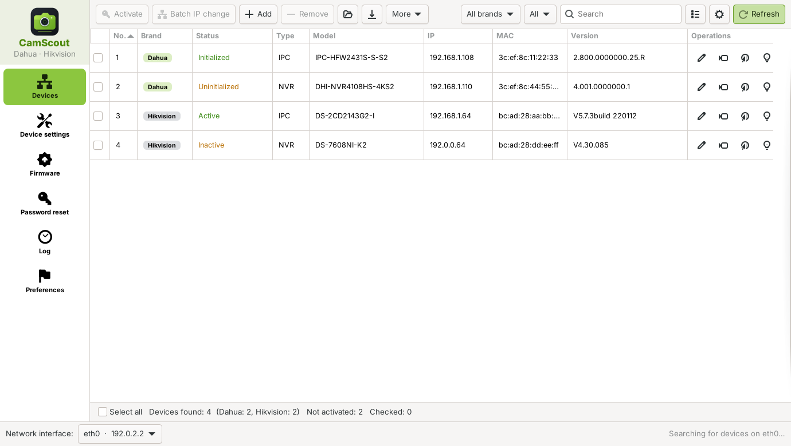
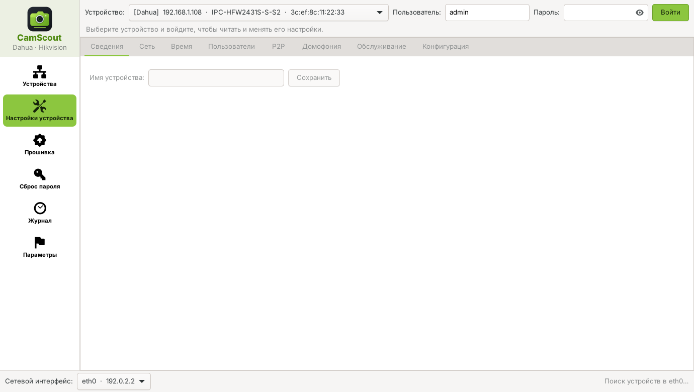
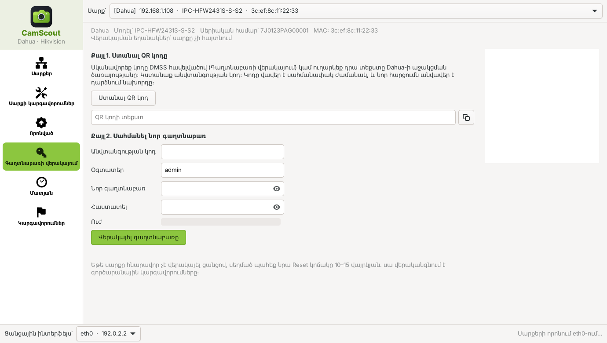

# CamScout

CamScout находит, активирует и настраивает в локальной сети устройства **Dahua** и **Hikvision**: IP-камеры, видеорегистраторы NVR/DVR/XVR и домофоны VTO/VTH. Это одна программа вместо двух прежних: [DahuaDeviceManager](https://github.com/Valeritylive/DahuaDeviceManager) и [hikvision-device-manager-linux](https://github.com/Valeritylive/hikvision-device-manager-linux). Интерфейс построен на GTK 4 по образцу Dahua ConfigTool; есть режим командной строки без графики.

Это независимый проект, не связанный с производителями устройств.



## Возможности

- **Устройства.** Общий список с колонкой «Бренд»: метка Dahua (салатовая) или Hikvision (серая), фильтр по бренду и по типу (IPC, NVR, DVR, XVR, SD, VTO, VTH…), строка поиска, выбор колонок. Поиск идёт одновременно по DHIP (Dahua, UDP 37810) и SADP (Hikvision, UDP 37020); в «Настройках поиска» любой бренд можно выключить.
  - **Активация** неактивных устройств обоих брендов в одном окне. Правила пароля и индикатор сложности свои у каждого бренда: Dahua 8–32 символа без `' " ; : &`, Hikvision 8–16 символов.
  - **Изменить IP**: для Dahua HTTP API в своей подсети или мультикаст по MAC в чужой; для Hikvision SADP по MAC или ISAPI (с DNS и IPv6). **Пакетная смена IP** работает и для смешанного списка.
  - **Добавить вручную** по IP (бренд определяется автоматически), импорт и экспорт CSV (читаются и списки прежних программ).
  - **Ещё**: синхронизация времени, перезагрузка, обновление прошивки и сведения по HTTP (Dahua); камеры за регистратором через HCNetSDK (Hikvision).
  - В колонке «Операции»: изменить IP, просмотр видео, веб-интерфейс, подробности.
- **Настройки устройства.** Для Dahua: сведения, сеть, время и NTP, пользователи, P2P, домофония, обслуживание, редактор конфигурации. Для Hikvision: сведения, сеть (ISAPI), порты, резервная почта и контрольные вопросы, обслуживание (GUID-файл, отвязка Hik-Connect).
- **Просмотр видео** по RTSP для обоих брендов: выбор канала и основного или дополнительного потока.
- **Обновление прошивки** Dahua (`.bin`), до 4 устройств одновременно.
- **Сброс пароля.** Dahua: QR-код для DMSS или техподдержки и код безопасности. Hikvision: файл-запрос (или GUID-файл) и файл-ответ от поддержки.
- **Журнал** операций и запись пакетов DHIP для отладки.
- **Язык интерфейса** выбирается в разделе «Параметры»: English (по умолчанию), русский, Deutsch, Español, Հայերեն. Выбор применяется сразу и сохраняется в `~/.config/camscout/settings.json`.

| Настройки устройства (русский) | Сброс пароля (армянский) |
| --- | --- |
|  |  |

## Как это работает

| Задача | Dahua | Hikvision |
| --- | --- | --- |
| Поиск | DHIP `DHDiscover.search`, UDP 37810 (мультикаст, широковещание, диапазон IP); старые DVR — UDP 5050 | SADP, UDP 37020 |
| Активация | DHIP-мультикаст по MAC (`DevInit.account`) | SADP по MAC, при ошибке ISAPI или HCNetSDK |
| Смена IP | HTTP API в своей подсети, `DHDiscover.setConfig` по MAC в чужой | SADP по MAC или ISAPI |
| Настройки | HTTP CGI с digest-аутентификацией | ISAPI |
| Видео | RTSP `/cam/realmonitor?channel=N&subtype=0/1` | RTSP `/Streaming/Channels/N01` или `N02` |

Если устройство отклонило пароль, второй способ не пробуется: несколько неверных паролей подряд блокируют учётную запись. Для поиска нужны входящие UDP 37810 и 37020, например `sudo ufw allow 37810/udp` и `sudo ufw allow 37020/udp`.

## Установка

Готовые пакеты (Flatpak, AppImage, `.deb`) собирает GitHub Actions; они появятся на странице [релизов](https://github.com/Valeritylive/CamScout/releases).

```bash
# Flatpak
flatpak install --user ./CamScout-x86_64.flatpak
flatpak run io.github.Valeritylive.CamScout

# AppImage
chmod +x CamScout-x86_64.AppImage && ./CamScout-x86_64.AppImage

# Debian/Ubuntu (заменяет пакеты hikvision-device-manager и dahua-device-manager)
sudo apt install ./camscout_2.0.0-1_amd64.deb
```

Собрать вручную: `bash build-appimage.sh`, затем `bash build-deb.sh`; Flatpak — `flatpak-builder --user --install-deps-from=flathub --force-clean --install build-dir flatpak/io.github.Valeritylive.CamScout.yml`. Версия берётся из файла `VERSION`, заметки к релизу лежат в `release-notes/`.

## Запуск из исходников на Debian/Ubuntu

```bash
sudo apt install python3 python3-gi python3-gi-cairo gir1.2-gtk-4.0 python3-requests python3-cryptography \
    python3-qrcode python3-gst-1.0 gstreamer1.0-plugins-good gstreamer1.0-plugins-bad gstreamer1.0-libav
python3 app.py
```

`python3-qrcode` нужен только для картинки QR-кода при сбросе пароля Dahua, GStreamer — только для просмотра видео.

## Режим командной строки

Без аргументов запускается графический интерфейс. Первый аргумент выбирает бренд:

```bash
camscout dahua discover                          # устройства Dahua
camscout dahua set-ip 3c:ef:8c:00:00:01 --ip 192.168.1.108 --mask 255.255.255.0 --gateway 192.168.1.1 --yes
DAHUA_PASSWORD='Str0ngPass1' camscout dahua init --all-uninitialized

camscout hikvision discover --format json        # устройства Hikvision (можно писать hik или sadp)
HIK_PASSWORD='Str0ngPass!' camscout hikvision activate --all-inactive
camscout hikvision set-ip 192.0.0.64 --ip 192.168.1.64 --gateway 192.168.1.1 --password-env HIK_PASSWORD --yes
```

Справка: `camscout dahua --help`, `camscout hikvision КОМАНДА --help`. Коды выхода: `0` — успех, `1` — ошибка хотя бы на одном устройстве, `2` — неверные аргументы или устройство не найдено.

## Разработка

- Тесты без сети и устройств: `python3 -m unittest discover -s tests`.
- Все строки интерфейса пишутся по-английски и оборачиваются в `tr()` из `i18n.py`; переводы лежат в `locales/<код>.json`. `python3 tools/extract_strings.py` показывает строки без перевода, `--keys` выводит все ключи.
- Модули: `app.py` (главное окно), `page_settings.py`, `page_reset.py`, `live_view.py`, `ui_common.py` (тема и общие виджеты); `devices.py` и `device_columns.py` — общая модель устройства и колонки; `dahua_*.py` и `sadp_*.py`, `hikvision_*.py`, `hik_ops.py` — протоколы брендов.

## Текущие ограничения

- Инициализация и сброс пароля Dahua по мультикасту и нативные SADP-команды восстановлены по открытому реверс-инжинирингу и проверены не на всех моделях; такие места помечены в коде комментарием `GUESS:`. Запись пакетов DHIP на странице «Журнал» поможет разобрать проблему.
- Мультикаст не проходит через маршрутизатор: для другого сегмента используйте диапазон IP в «Настройках поиска».
- Обновление прошивки и редактор конфигурации есть только для Dahua. HCNetSDK для операций через регистратор Hikvision ставится отдельно (`HIKVISION_HCNETSDK_LIBRARY`).
- Справка командной строки пока на русском.
